<div align="center">
  
</div>

<div align="center">

[](https://www.linkedin.com/in/abdelfattah-khaled)
[](https://wa.me/1150076026)
[](mailto:abdelfattahk719@gmail.com)


</div>


<table width="100%">
<tr>
<td width="48%" valign="middle">

**Mechatronics Engineer** working where hardware meets software.
I design boards, write firmware and ship products under **Micro Forge**.

> *"Turning silicon into intelligence, one line of C at a time."*

```yaml
role:      Embedded Systems Architect
focus:     Firmware, PCB Design, IoT, Automation
mcu:       STM32, ESP32, Arduino
protocols: Modbus, MQTT, I2C, SPI, UART
```

</td>
<td width="52%" align="center" valign="middle">
</td>
</tr>
</table>

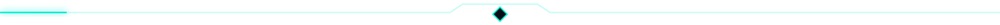


<div align="center">
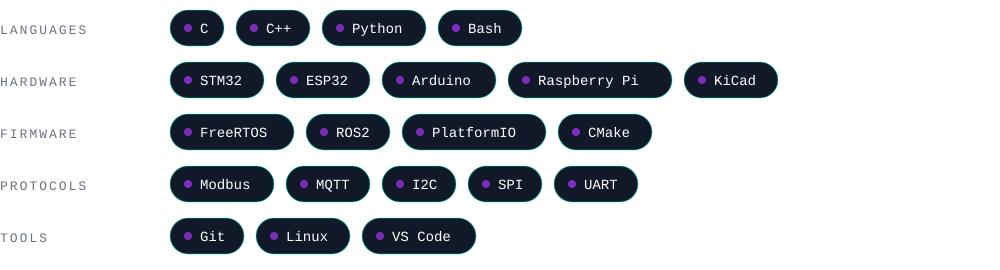
</div>



<div align="center">
<table>
<tr>
<td>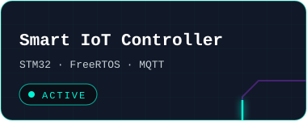</td>
<td>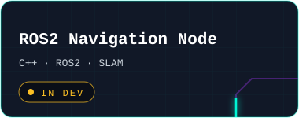</td>
<td>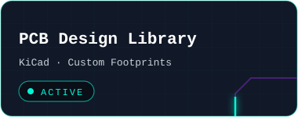</td>
</tr>
<tr>
<td>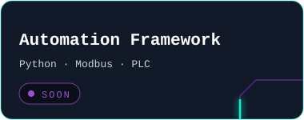</td>
<td><a href="https://github.com/abdelfattahKGD">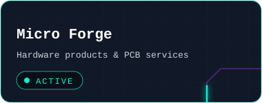</a></td>
<td><a href="mailto:abdelfattahk719@gmail.com">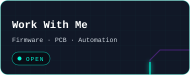</a></td>
</tr>
</table>
</div>



<div align="center">


<picture>
  <source media="(prefers-color-scheme: dark)" srcset="https://raw.githubusercontent.com/abdelfattahKGD/abdelfattahKGD/output/github-snake-dark.svg" />
  <source media="(prefers-color-scheme: light)" srcset="https://raw.githubusercontent.com/abdelfattahKGD/abdelfattahKGD/output/github-snake.svg" />
  
</picture>

</div>

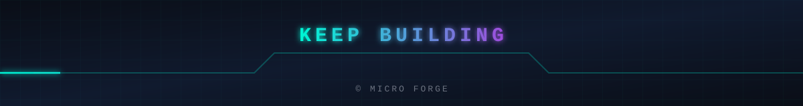
